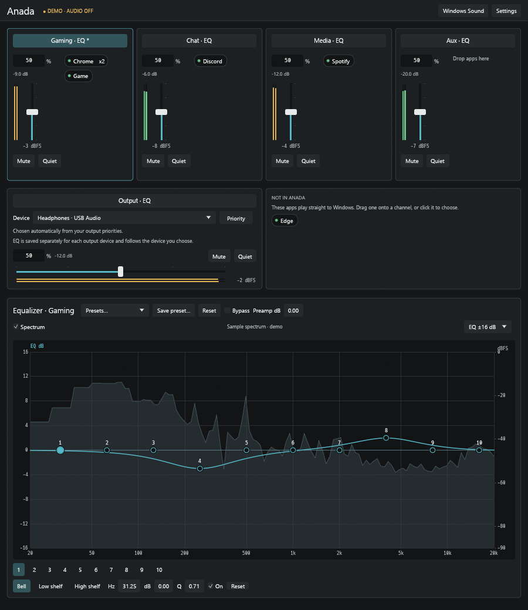

# Anada

A Windows listening mixer. Anada gives you four playback channels (Gaming, Chat, Media
and Aux), lets you route each app to one of them, and mixes them with per-channel and
per-output-device EQ onto the headphones or speakers you listen on.

Spectrum shows "Funkorama" by Kevin MacLeod (incompetech.com), licensed under CC BY 4.0.

- **Four channels** with Windows-backed volume, mute and a Quiet toggle, plus live
  signal meters.
- **App routing** by drag and drop, a click menu or keys 1-4. Anada sets the Windows
  per-app playback preference for every process of an app.
- **10-band parametric EQ** per channel and per output device, with presets and a live
  spectrum.
- **Output priorities**: Anada picks the best connected device and switches when
  devices come and go; output EQ follows the device.
- **Windows stays in charge**: endpoint volume and mute are the only volume controls,
  and Anada never changes them behind your back.
- **Tray host and sign-in startup**: closing the window keeps audio running.
- **Agent access (MCP)**: optional, timed, per-permission access for a local AI agent.

## Install

Anada uses [Virtual Audio Cable](https://vac.muzychenko.net/) (VAC) for its four
channels; install it first (it is licensed separately by its vendor). Then run the
Anada installer and **Set up Virtual Audio Cable** from its Start menu folder. The [user guide](docs/GUIDE.md)
walks through setup, daily use, updates and removal.

## Build from source

Anada targets 64-bit Windows and builds with the Rust toolchain pinned in
`rust-toolchain.toml` (GNU target with MinGW-w64):

    cargo build --workspace --locked
    ./target/debug/anada.exe

`anada.exe --ui-demo` opens the interface with sample data and no audio. See
[Development](docs/DEVELOPMENT.md) for tests and UI review, and
[packaging/README.md](packaging/README.md) to build the installer.

## How it works

The window (`anada.exe`) talks to a background host (`anada-host.exe`) over a local
named pipe. The host captures the four VAC lines, resamples them to the output
device's rate with clock-drift correction, applies EQ, mixes and renders through
WASAPI shared mode. See [Architecture](docs/ARCHITECTURE.md) and
[MCP access](docs/MCP.md).

| Area | Choice |
| --- | --- |
| Language | Rust |
| Interface | egui + eframe |
| Audio I/O | CPAL (WASAPI shared mode) |
| Windows APIs | windows-rs |
| DSP | biquad EQ, Rubato sinc resampling, rtrb lock-free queues |
| IPC and settings | Named pipes, versioned JSON |
| Installer | NSIS, per user |

## License

Anada is free software under the [GNU General Public License v3.0 or later](LICENSE).
If you distribute a modified version, you must release its source under the same
license. Third-party components keep their own licenses; their notices are in
`packaging/third-party/` and ship with the installer.
